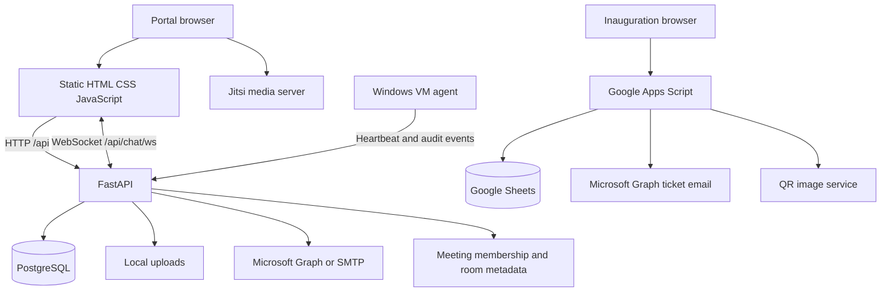
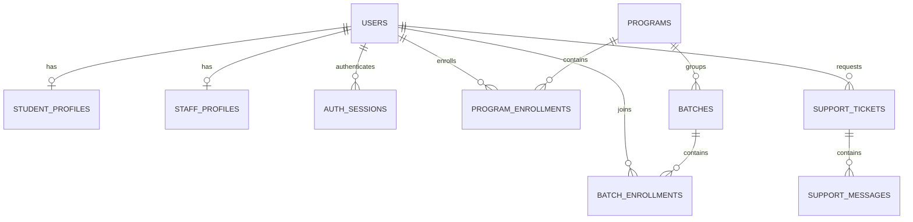

# Arckenites project report and development roadmap

**Source snapshot:** 17 October 2026, commit `f306d1c` on `main`.

**Purpose:** explain the existing application so a developer or coding assistant can extend it without replacing working systems or confusing code availability with production readiness.

This is a repository assessment. It includes source inspection and the results of the earlier student provisioning test run in this session. It is not a penetration test or proof that every feature works on the deployed server. The GitHub push succeeded; the deployment workflow outcome, live database revision, configured cloud services, and real Windows VM enforcement have not been verified here. No application code was changed while preparing this report.

## 1. Project overview

Arckenites is a training institute website and operations portal. It contains public marketing pages, an administration portal, trainer workspaces, student accounts, community registration and announcements, communication tools, support, scheduled meetings, lab booking, and VM access management.

Two additional systems live in the same repository:

- An independent inauguration event website with Google Sheets registration, PDF tickets, QR verification, and Microsoft Graph ticket email through Google Apps Script.
- A Windows service that enforces the portal's lab VM access decisions on individual Windows machines.

The application has substantial administrative functionality. It is not yet a complete learning management system: course/module progression, a complete assignment and assessment system, attendance, payments, and certificate issuance should not be assumed from sidebar labels or support-ticket categories.

### Source inventory

Counts come from a static inventory of the snapshot, excluding ignored runtime files.

| Item | Count |
|---|---:|
| Tracked files before this report | 308 |
| Main website/portal HTML pages | 55 |
| Main frontend JavaScript files | 42 |
| API route modules | 33 |
| API route declarations, including WebSocket | 228 |
| SQLAlchemy model tables | 44 |
| Alembic migration files | 37 |
| Python test files | 9 |
| Declared test methods | 112 |

The complete route list, handler locations, table columns, foreign keys, migration chain, configuration key names, and source sizes are in [docs/project-inventory.json](docs/project-inventory.json). Counts describe source declarations, not independently verified feature completeness.

## 2. Repository map

```text
arckenites-orange/           Main marketing website and authenticated portal
  *.html                    Public, admin, student, trainer, community pages
  js/api.js                 Shared HTTP client and browser session storage
  js/auth.js                Login routing, role/page guards, sidebar permissions
  js/admin-*.js             Individual admin modules
  js/student-dashboard.js   Student dashboard behavior
  js/staff-*.js             Trainer dashboard, workspace, support
  js/chat.js                Shared direct chat and WebSocket client
  js/meeting-room.js        Scheduled meeting UI and Jitsi integration
  js/video-conference.js    Separate legacy/ad-hoc video helper
  css/style.css             Main shared design system and page styles
  assets/                   Branding and public images

backend/
  app/main.py               FastAPI application, routers, middleware, workers
  app/config.py             Environment-based settings
  app/database.py           Engine, SessionLocal, get_db, ORM Base
  app/api/routes_*.py       HTTP/WebSocket handlers and authorization gates
  app/schemas/              Pydantic request and response contracts
  app/models/               SQLAlchemy entities and relationships
  app/crud/                 Shared persistence, permission, audit helpers
  app/core/                 Auth, email, uploads, lab, meeting and worker logic
  alembic/versions/         Ordered database migrations
  tests/                    unittest regression and PostgreSQL integration tests
  uploads/                  Ignored runtime data; must be preserved separately
  seed.py                   RBAC sync plus separate bootstrap/demo path
  docker-compose.yml        Local PostgreSQL service definition
  render.yaml               Alternative Render hosting configuration
  MEETINGS_DEPLOYMENT.md     Jitsi/Jibri infrastructure notes
  STUDENT_EMAIL_PROVISIONING.md  Recent feature details and operating commands

inauguration/
  index.html                Independent event landing page and registration UI
  css/style.css             Event-only styling
  js/app.js                 Registration, validation, theme/audio interactions
  google-apps-script.gs     Sheets, PDF ticket, email, verification, trigger code
  README.md                 Setup notes; some descriptions are outdated

windows-lab-agent/
  agent_core.py             Polling and Windows authorization enforcement
  service.py                Windows Service integration
  install.ps1               Service installation
  uninstall.ps1             Service removal
  config.ini.example        Per-machine configuration template

.github/workflows/deploy.yml  Push-to-main deployment workflow
deploy.sh                    Server update, migration, RBAC sync, health checks
```

There is no frontend npm build pipeline or SPA framework in this snapshot. HTML and JavaScript are served directly. Do not introduce a new frontend build system merely to make a small feature change.

## 3. Technology and runtime architecture

| Layer | Implementation in source |
|---|---|
| Main frontend | HTML, CSS, plain JavaScript; Bootstrap 5.3.3 on inspected public pages |
| UI assets | Font Awesome, Google Fonts, AOS on inspected public pages; local images |
| Backend | Python 3.11, FastAPI 0.115.0, Uvicorn |
| Persistence | PostgreSQL, SQLAlchemy 2.0.52, psycopg 3 |
| Schema evolution | Alembic 1.13.2 |
| Request/settings validation | Pydantic and pydantic-settings |
| Passwords and sessions | bcrypt 4.2.0, PyJWT 2.9.0, database-backed AuthSession rows |
| Email | Shared Microsoft Graph/MSAL transport, otherwise SMTP |
| Spreadsheet export | openpyxl |
| Live messaging | FastAPI WebSockets, process-local connection manager |
| Scheduled meetings | Jitsi external API, portal-side membership and meeting records |
| Event ticket backend | Google Apps Script, Google Sheets, Graph, external QR image service |
| VM enforcement | Python Windows service, pywin32, per-VM API bearer token |
| Deployment | Self-hosted GitHub Actions runner, Bash, systemd; Caddy described in deployment notes |

Versions above describe repository declarations, not a dependency currency or vulnerability assessment.



The inauguration path does not use FastAPI, the portal login, or PostgreSQL. Its Microsoft credentials are configured separately in Apps Script, even if the same organization supplies both email senders.

## 4. Roles, authentication, and authorization

### Top-level roles

| Role value | Purpose |
|---|---|
| `admin` | Operational administration, with additional RBAC tier and permissions |
| `staff` | Trainer dashboard, assigned batches, resources, support and communication |
| `student` | Student login, onboarding, assigned programs/batches, support and learning resources |
| `community` | Public self-registration, community dashboard and member announcements |

Admin subroles include Super Admin, Admin, Support Admin, Leads Admin, Lab VM Admin, and custom roles. The permission catalog and default grants live in `backend/app/crud/permissions.py`. Super Admin access is computed specially rather than depending on grant rows for every permission.

Most admin operations use `require_permission("module.action")`. Student/trainer endpoints use role checks and, where relevant, batch or record ownership checks. Some dashboard/health/contact-enquiry operations are gated only to the admin role; permission coverage is not universal. UI permission hiding in `js/auth.js` is supplementary; backend authorization must remain authoritative.

### Password login and session flow

1. Browser submits `username` and `password` to `POST /api/auth/login`.
2. Backend loads the account, applies active-account, lockout and maintenance checks, and verifies bcrypt.
3. Successful login creates a signed JWT and an `auth_sessions` row with its JTI.
4. The response includes the caller's user details and effective permissions.
5. Browser stores the token and user snapshot in **sessionStorage**, through `js/api.js`.
6. Authenticated HTTP requests send `Authorization: Bearer ...`.
7. `get_current_user` verifies JWT validity, session existence/revocation/expiry, and active account status.
8. Logout revokes the current database session and clears browser session state.

Do not describe this system as JWT-only authentication: database sessions are necessary for revocation. Do not switch storage or token semantics as an incidental feature change.

New student email IDs are trimmed and lowercased during creation. Student email login accepts case/whitespace variations. Exact matching for existing Admin/Trainer usernames is retained; legacy student login IDs are preserved.

The browser routes students through `change-password.html` when `must_change_password=true`, then through `complete-profile.html` if contact details are incomplete. These frontend redirects are onboarding behavior; the general API dependency does not itself restrict every request during a forced-password-change state.

Google sign-in is implemented for existing Admin/Trainer/Student accounts using state, nonce, ID-token validation, linked identities, and a one-time exchange ticket. It is not a replacement registration flow and does not provision Community accounts.

## 5. Main modules and current boundaries

“Implemented” below means a source path exists. External-service behavior still needs environment-specific verification.

| Module | Present implementation | Boundary or incomplete area |
|---|---|---|
| Public website | Home, programs, courses marketing, contact, trainers, placements, careers, legal pages | Static marketing content is not automatically the backend Program catalog |
| Student administration | Email login creation, program assignment/enrollment, status/edit/reset, deletion/deactivation, Excel export, credential email/resend | Production migration and real email delivery still need confirmation |
| Trainer administration | Trainer creation/edit/status/reset and profile data | Trainer login behavior differs from new student email provisioning; preserve it |
| Admin users/RBAC | Roles, permissions, admin users, session revocation, audit records | Check role-only endpoints before promising complete granular isolation |
| Programs | Catalog, details, enrollment management, program-linked batches | Legacy enum and catalog representation coexist |
| Batches | Trainer allocation, student allocation, schedules, resources, group chat and members | `Batch.course` remains text; no standalone course/module engine |
| Student portal | Institutional dashboard, profile, batches, resources, schedule, support, labs and meetings | Non-Institutional students receive a much smaller fallback dashboard |
| Trainer portal | Dashboard, assigned batch workspace, materials/videos, support and communication | Verify trainer ownership on each new operation |
| Support | Tickets, messages, assignments/statuses, internal notes, authenticated attachments | Shared admin read state, not a separate unread state per admin |
| Direct/group communication | Direct chat, batch messages, unread state and WebSocket events | Registry is local to one process; socket revocation needs attention |
| Leads and enquiries | Lead CRUD/statuses/export; public contact submissions and admin review | A lead marked converted is not proof of an automatic lead-to-student provisioning workflow |
| Community | OTP registration, password setup, profiles, public/member posts, queued announcement email | Duplicate registration responses reveal account/contact existence |
| Meetings | Scheduling, membership, join/waiting/admission, chat, notes, participants, recording state | Jitsi token enforcement and a finished recording pipeline are incomplete |
| Slot-based labs | Slots/bookings, hour/capacity policies, automatic/manual lock state | Slot constants are source-defined policy; distinguish from VM enforcement |
| VM lab access | VM inventory, per-student grants, expiry, rotating password, heartbeat/audit, RDP downloads | Actual Windows enforcement remains unverified on real hardware in project notes |
| Inauguration | Registration, unique ticket IDs, queued PDF/email processing, QR verification | Separate deploy/trigger/secrets; no authenticated attendance/check-in workflow |

The newsletter handler in `arckenites-orange/js/script.js` currently changes the field to a success message without submitting to a subscription service. Treat it as a demo interaction.

Companies, Job Opportunities and Placement Statistics appear as disabled “Soon” items. Support categories mentioning assignments, assessments, fees or certificates do not establish those modules as built.

## 6. Database model and important relationships

### Table groups

| Domain | Tables |
|---|---|
| Identity/RBAC | `users`, `student_profiles`, `staff_profiles`, `admin_profiles`, `admin_roles`, `permissions`, `admin_role_permissions` |
| Sessions/security | `auth_sessions`, `auth_audit_log`, `user_google_identities`, `google_login_tickets`, `system_settings` |
| Training | `programs`, `program_enrollments`, `batches`, `batch_enrollments`, `class_sessions`, `study_materials`, `class_videos`, `interview_schedules` |
| Messaging | `conversations`, `direct_messages`, `batch_messages`, `batch_chat_read_state` |
| Support | `support_tickets`, `support_messages`, `support_attachments` |
| Community | `community_registrations`, `community_profiles`, `community_posts`, `community_post_email_deliveries` |
| Sales/contact | `leads`, `contact_enquiries` |
| Lab scheduling | `lab_slot_bookings`, `lab_access_overrides`, `lab_access_audit_log` |
| Lab machines | `lab_vms`, `lab_vm_access`, `lab_vm_access_audit_log` |
| Meetings | `meetings`, `meeting_participants`, `meeting_messages`, `meeting_notes`, `meeting_recordings` |



Additional relationships:

- A batch has an assigned trainer and links to a program. Students are allocated to batches rather than directly to trainers.
- ProgramEnrollment is unique per student/program and records status history. A student may have multiple program enrollments.
- `student_profiles.program_id` identifies a primary catalog program for newly assigned students. The legacy `student_profiles.program` enum remains for compatibility and existing dashboard behavior.
- A student's contact email can be changed through profile editing without renaming the login ID. Future email-change features need an explicit, verified identity-change design.
- Audit history is preserved where deletion paths detach or deactivate accounts. A student with related history is deactivated rather than having that history removed.
- Uploaded files live on disk; table rows store storage references and metadata. A database backup alone is insufficient to restore them.

### Migration state

The repository contains one migration head: **`c6e8a2b4d9f1`**. This does not prove the deployed database is at that head.

The latest migration widens `users.username` to 255 characters, adds normalized email-login uniqueness, and adds nullable `student_profiles.program_id`. It checks for duplicate normalized email-style logins before changes and refuses to silently merge, rename or delete accounts. See [backend/STUDENT_EMAIL_PROVISIONING.md](backend/STUDENT_EMAIL_PROVISIONING.md) for the preflight query and operational details.

Never edit applied migrations to retrofit a new feature. Add a new migration, define a safe backfill if needed, and preserve legacy nullable data until it can be resolved explicitly.

## 7. Recent student email provisioning change

Commit `f306d1c` introduced this flow:

```text
Authorized admin selects Add New Student
  -> name + candidate email + temporary password + catalog program ID
  -> validate and normalize email
  -> reject duplicate login/known legacy student contact email
  -> bcrypt password hash
  -> create User + StudentProfile + active ProgramEnrollment + audit entry
  -> commit the transaction
  -> send branded credential email through the shared provider
  -> return created student and email-delivery status
```

Request example:

```json
{
  "full_name": "Arun Kumar",
  "email": "arun@example.com",
  "temp_password": "<temporary password supplied by admin>",
  "program_id": 1
}
```

Relevant routes:

- `POST /api/admin/students`
- `GET /api/admin/students/program-options`
- `POST /api/admin/students/{student_id}/credentials-email`
- Existing list, PATCH, DELETE and Excel export routes remain.

Credential email failure returns a created account with a warning; it does not delete the student. A resend requires the original temporary password, verifies it against bcrypt, and does not reset it. Plaintext credentials are not stored in a database queue or returned by the API. New temporary passwords are limited to bcrypt's 72 UTF-8-byte boundary.

The full change report and precise commands are in [backend/STUDENT_EMAIL_PROVISIONING.md](backend/STUDENT_EMAIL_PROVISIONING.md).

## 8. Email, integrations, and background work

### Portal email

`backend/app/core/email.py` chooses Graph when all Graph settings are configured; otherwise it uses SMTP. A Graph send failure is not silently retried through a different SMTP sender. The detailed result distinguishes acceptance and certain failure categories.

Callers include Community OTP, student credential delivery, notification helpers, and Community post delivery. Notification preferences apply to the relevant notification path, not necessarily every transactional email.

Community post email delivery has database queue rows, claiming, delivery status and bounded backoff. Student credentials intentionally do not use that content-persisting queue because doing so would persist a recoverable password; the admin resend flow supplies the original password again.

`main.py` starts two background loops: the VM expiry watchdog and Community post email worker. They run inside API processes. Moving to multiple workers or replicas requires explicit coordination and monitoring, not just increasing Uvicorn worker count.

### Inauguration ticket pipeline: actual current source

1. Event browser posts JSON as `text/plain` to the configured Apps Script `/exec` URL.
2. `doPost` acquires a script lock, checks required fields and duplicate email, allocates a ticket ID, and saves the registration with Pending statuses.
3. It returns after saving. PDF generation and email are not completed in that browser request.
4. `resendFailedTickets` processes pending/unsent rows, builds a PDF, and calls Microsoft Graph with the attachment.
5. A time-driven trigger, installed by `createPendingTicketsTrigger_setup`, runs the processor every minute.
6. QR images encode the Web App's ticket-verification URL. `doGet` renders limited ticket details.

The logo is currently embedded in source as base64; it is not fetched live on every send. The QR image still uses an external service. The event date/time/venue are constants in the script and website and need coordinated updates if the event changes.

**Documentation drift:** the event README still describes MailApp email, live logo fetching and parts of an older synchronous/manual-retry flow. For implementation details, the current `.gs` functions take precedence. Refresh the README before using it as an operating guide.

The script and HTML both contain a configured `/exec` URL. Presence in source is not proof that the deployed Google script matches this version, that its Graph credentials are set, or that the timed trigger exists.

## 9. Configuration and secrets

| System | Configuration keys / location |
|---|---|
| Database | `DATABASE_URL` in backend environment |
| JWT/session | `JWT_SECRET`, `JWT_TTL_MIN`; some runtime security settings live in `system_settings` |
| Runtime/origins | `ENV`, `CORS_ORIGINS`, `PUBLIC_SITE_URL` |
| Google sign-in | `GOOGLE_CLIENT_ID`, `GOOGLE_CLIENT_SECRET`, `GOOGLE_REDIRECT_URI` |
| Portal Graph | `MS_GRAPH_TENANT_ID`, `MS_GRAPH_CLIENT_ID`, `MS_GRAPH_CLIENT_SECRET`, `MS_GRAPH_SENDER_EMAIL` |
| Portal SMTP | `SMTP_HOST`, `SMTP_PORT`, `SMTP_USERNAME`, `SMTP_PASSWORD`, `SMTP_FROM_ADDRESS`, `SMTP_FROM_NAME` |
| Meeting metadata | `MEET_DOMAIN` plus separately managed Jitsi infrastructure |
| Bootstrap | `SEED_ADMIN1_USERNAME`, `SEED_ADMIN1_PASSWORD`; not a production reset mechanism |
| Event Graph | Apps Script Properties: `GRAPH_TENANT_ID`, `GRAPH_CLIENT_ID`, `GRAPH_CLIENT_SECRET` |
| Event sender/processor | `GRAPH_SENDER_ADDRESS` in script source; timed trigger in Apps Script deployment |
| VM agent | Per-machine `config.ini`: API origin, agent token, poll/failure policy, protected accounts |

The earlier local inspection found no complete Graph or SMTP configuration in the backend environment. Production credentials were not read or verified. No secret values are included in this report or inventory.

`.env`, uploads, virtual environments and the real VM agent `config.ini` are ignored by Git. Keep that separation. Deployment settings in `.env.example` and `render.yaml` are templates, not evidence of active infrastructure.

## 10. Deployment and operational state

The GitHub repository is `ReinsteinsTechnology2026/Arckenites_Website-`, branch `main`. The most recent feature commit was successfully pushed in this session.

The checked-in GitHub Actions workflow runs on pushes to `main`, using a self-hosted runner. It copies and executes `deploy.sh`. The script fetches source, stops the systemd backend before changing code/schema, installs dependencies, runs migrations, syncs RBAC with `seed.py --rbac-only`, restarts the service, and performs HTTP checks.

Default server paths are `/opt/arckenites`, `/opt/arckenites/backend`, and `/opt/arckenites/arckenites-orange`. The backend service is `arckenites-backend`. Deployment notes describe Caddy proxying same-origin `/api` traffic; the frontend client uses `http://localhost:8000/api` only on localhost/127.0.0.1 and `/api` otherwise.

Operational checks still required:

- Confirm the GitHub run for `f306d1c` succeeded and the server is running that source.
- Confirm `alembic current` reports `c6e8a2b4d9f1`.
- Confirm whether the production frontend directory is a separate Git checkout or part of the app checkout; `deploy.sh` issues Git operations for both locations.
- Verify welcome email acceptance and actual receipt with a real test mailbox.
- Verify the event's deployed script version, Script Properties, timed trigger and ticket delivery.
- Verify Jitsi reachability/auth configuration and VM agent installation on actual machines.
- Back up and restore PostgreSQL and runtime uploads together; document secret recovery separately.

`GET /api/health` is currently a liveness response returning `{"status":"ok"}`. It does not query PostgreSQL or verify that migrations are current. The admin system-health route does a database check, but the deployment script's public health call cannot by itself establish database readiness.

The workflow currently deploys without a test step. Add a test gate and a staging validation path before making larger releases. Render configuration is present as another hosting option; its presence does not establish that production uses Render.

Do not run the full bootstrap `seed.py` casually in production: the full path creates demo accounts. Use `--rbac-only` for the existing production deploy. Some seed/render comments describe older bootstrap behavior and should be reconciled with the current function bodies.

## 11. Security and reliability work to prioritize

These are source-based findings and development recommendations. They were not fixed as part of this reporting task and have not been exploited against a live service.

| Priority | Finding and evidence | Development action |
|---|---|---|
| P0 | Admin dashboard inserts `actor_name` and `message` into HTML/attributes without escaping. Activity can include public failed-login `username_attempted` values. Sources: `js/admin-dashboard.js`, `routes_dashboard.py`, `routes_auth.py`. | Render activity/notifications with text nodes or context-appropriate escaping; add a regression test tracing untrusted login input into the dashboard. Treat this as a stored-XSS path, not merely an appearance issue. |
| P1 | Existing chat sockets authenticate at connection time; `chat_ws` does not revalidate the session/account in its receive loop. | Ensure expired/revoked/disabled sessions lose existing socket access; test both send and receive behavior. |
| P1 | Student admin password reset updates the hash without calling `revoke_all_sessions` in that branch; ordinary password change also leaves other sessions intact. | Define and enforce reset/change revocation policy; preserve only the intended current session if appropriate. |
| P1 | Legacy video helper hardcodes `localhost:8443`, while scheduled meetings use `MEET_DOMAIN`. | Unify meeting host configuration and remove development-only assumptions from deployed video paths. |
| P1 | Jitsi room membership is checked in the app, but join payload/options do not contain a backend-issued Jitsi JWT. | Implement media-server token enforcement before relying on portal membership as the full media security boundary. |
| P1 | Community registration returns distinct duplicate email/mobile responses despite older generic-response comments. | Make an explicit product decision about enumeration; use consistent generic behavior if account privacy is required. |
| P1 | Inauguration `?endpoint=` override works without a localhost-only guard. | Restrict it to development or remove it in production so a crafted event-page link cannot redirect submitted contact details to an arbitrary endpoint. |
| P1 | Main push workflow has no test stage; liveness endpoint does not verify database readiness. | Add isolated test gating, readiness checks, migration verification and deployment status reporting. |
| P1 | Event README disagrees with Graph/queued-trigger implementation. | Publish a current runbook and verify the processor trigger; otherwise saved registrations can remain Pending indefinitely. |
| P2 | WebSocket registry and rate limiting are process-local; background loops start per API process. | Define worker/replica strategy before scaling; introduce shared coordination/fanout only when that deployment requires it. |
| P2 | Uploaded-file checks primarily inspect extension and size; upload bodies are read before that size check in inspected routes. | Add content validation and request-size limits at the appropriate boundaries; verify download ownership and storage backups. |
| P2 | General FastAPI validation responses can include rejected input; provisioning POSTs have a scoped redaction handler. | Extend secret-safe error handling deliberately to other password-bearing schemas without breaking API clients. |
| P2 | Many route handlers commit independently, and audit helpers commit by default. | For new multi-record writes, stage audit with `commit=False` and use one owning transaction; add failure-path tests. |

An HTTP health check, an API unit test, and a successful email provider response establish different things. Record them separately in release reports.

## 12. Test coverage and confidence

The earlier full test run for the provisioning implementation reported **112 tests: 98 passed, 14 skipped, zero failures**. All **27 new provisioning/migration regression tests** passed. The skipped tests were the pre-existing live PostgreSQL integration tests because a local database was unavailable. These are prior session results, not a fresh test run for this report.

The nine test files cover RBAC, auditing, Google authentication, OTP, admin update transactions, student deletion, and student creation. The new tests use real ORM/HTTP flows against temporary SQLite databases with test-only adaptations and a mocked email boundary. Migration guards and PostgreSQL index SQL are checked, but this does not prove live PostgreSQL DDL or advisory-lock behavior.

JavaScript syntax checks and a simulated-DOM student form smoke check passed earlier. There is no checked-in full browser test suite in this snapshot. The event README references a scratchpad test outside the repository; do not count that as a reproducible checked-in test artifact.

Next coverage targets: live PostgreSQL migration/rollback constraints, revoked WebSocket sessions, record ownership across student/trainer/batch APIs, upload authorization/limits, Community delivery claiming/retry, live Jitsi joins, event trigger execution, and Windows Service enforcement on a real VM.

## 13. Development roadmap

The order below is a suggested implementation sequence, not a promise of delivery dates.

### Stage A: establish a safe working baseline

1. Confirm the latest deployment, schema revision and real welcome email.
2. Fix dashboard stored XSS and add a regression test.
3. Close session-revocation gaps in password reset/change and WebSockets.
4. Add CI tests and a database-aware readiness check.
5. Update and verify the event operating guide and trigger.
6. Create a documented database/upload restore exercise and staging environment.

Exit criteria: releases have reproducible evidence, sensitive admin views safely display untrusted content, and revoked credentials lose ongoing access.

### Stage B: make the core training experience consistent

1. Give all assigned programs a usable student dashboard instead of relying on the Institutional slug gate.
2. Design a real Course -> Module -> Lesson structure. Add nullable foreign keys beside legacy fields first; do not discard `Batch.course` or historical program data.
3. Connect materials/videos to course structure with publication and access rules.
4. Implement assignments/submissions and trainer review using explicit ownership checks.
5. Add attendance records and measurable progress based on actual records.

Exit criteria: a student in any supported program can see their assigned learning content and demonstrable progress, and a trainer can manage only authorized batches/content.

### Stage C: finish adjacent operational modules

1. Implement the company/job/candidate placement workflow behind the existing placeholders.
2. Add certificate issuance/verification if needed by the training process.
3. Define fee/payment requirements before selecting any payment integration.
4. Complete Jitsi JWT enforcement and real recording finalization/storage if recording is a product requirement.
5. Validate VM grant/revoke/expiry/failsafe behavior on a test Windows VM before expanding lab access.
6. Add an authenticated event desk check-in workflow if attendance scanning is required; existing QR verification is read-only.

### Stage D: reduce maintenance cost and support growth

1. Extract shared UI/navigation/form helpers incrementally. Avoid a whole-app rewrite as a prerequisite.
2. Split the largest scripts and route modules by feature while preserving public API contracts.
3. Add pagination where lists grow, inspect query counts, and add indexes based on actual access patterns.
4. Move to shared realtime coordination and persistent worker infrastructure when adopting multiple workers/replicas.
5. Centralize observability for failed deliveries, stuck queues, offline agents and failed deployment phases.

## 14. Safe workflow for the next feature

1. Name the affected subsystem: portal, inauguration, or Windows agent.
2. Read the related page script, API schema, handler, models, permissions and existing tests.
3. State which files/contracts must change before editing.
4. Reuse `ArckAPI`, `ArckAuth`, existing design classes, FastAPI dependencies, `get_db`, hashing, audit and email helpers.
5. Put authorization and record ownership checks on the backend.
6. Use real relationships for Program/Batch/Course assignments and one transaction for coupled writes.
7. Use additive Alembic migrations with preflight/backfill plans for existing data.
8. Keep credentials out of Git, browser code, logs and API responses.
9. Add tests for success, forbidden access, validation, duplicate/concurrent input and rollback paths relevant to the change.
10. Report local results separately from live infrastructure verification.
11. Review the change before pushing: `main` triggers deployment. A request to write documentation does not itself require a production push.

For a ready-to-paste development context, use [PROJECT_CONTEXT.md](PROJECT_CONTEXT.md). For the exact API/table inventory, use [docs/project-inventory.json](docs/project-inventory.json).

## 15. Local development quick start

These are setup instructions, not commands executed as part of this report. Use a dedicated local database. Do not point bootstrap or integration tests at production.

From the repository root, prepare Python 3.11 and the existing dependencies:

```powershell
Set-Location backend
python -m venv .venv
.\.venv\Scripts\python.exe -m pip install -r requirements.txt
if (-not (Test-Path .env)) { Copy-Item .env.example .env }
```

Edit only the local `.env`: supply the local `DATABASE_URL`, a development JWT secret, `ENV=development`, a deliberate bootstrap-admin password, and `PUBLIC_SITE_URL=http://localhost:5500` if testing links locally. Keep localhost/127.0.0.1 port 5500 in `CORS_ORIGINS`. Leave outbound email unconfigured unless testing through an appropriate mailbox.

The checked-in Compose definition exposes PostgreSQL on host port **5433**. With Docker running, from `backend/`:

```powershell
docker compose up -d db
.\.venv\Scripts\python.exe -m alembic upgrade head
# Dedicated local development database only: creates bootstrap/demo accounts.
.\.venv\Scripts\python.exe seed.py
.\.venv\Scripts\python.exe -m uvicorn app.main:app --host 127.0.0.1 --port 8000
```

Set the local database URL to match the credentials and database in `backend/docker-compose.yml`. If using another local PostgreSQL instance, use that instance's port and credentials instead.

In another terminal, from the repository root:

```powershell
python -m http.server 5500 --bind 127.0.0.1 --directory arckenites-orange
```

Open `http://127.0.0.1:5500/login.html`. FastAPI's generated API documentation is available at `http://127.0.0.1:8000/docs` when the app is running.

For the independent event frontend:

```powershell
python -m http.server 5600 --bind 127.0.0.1 --directory inauguration
```

This serves the browser files only; it does not emulate Google Apps Script, send a PDF, or create the required cloud trigger. Submitting the configured event form may contact the real deployed script, so use deliberate test data and avoid assuming a local static server isolates the external integration.

For the safe isolated unittest command, use the Tests section of [backend/STUDENT_EMAIL_PROVISIONING.md](backend/STUDENT_EMAIL_PROVISIONING.md). That command deliberately keeps existing live-PostgreSQL fixtures away from a real database while the new provisioning tests create their own temporary databases.
